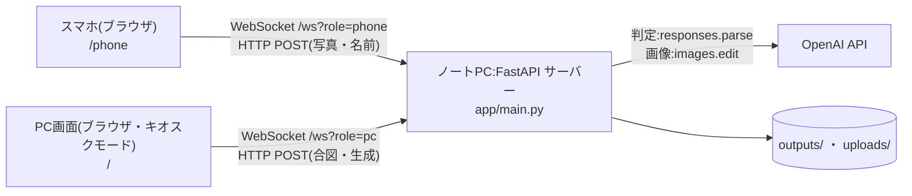
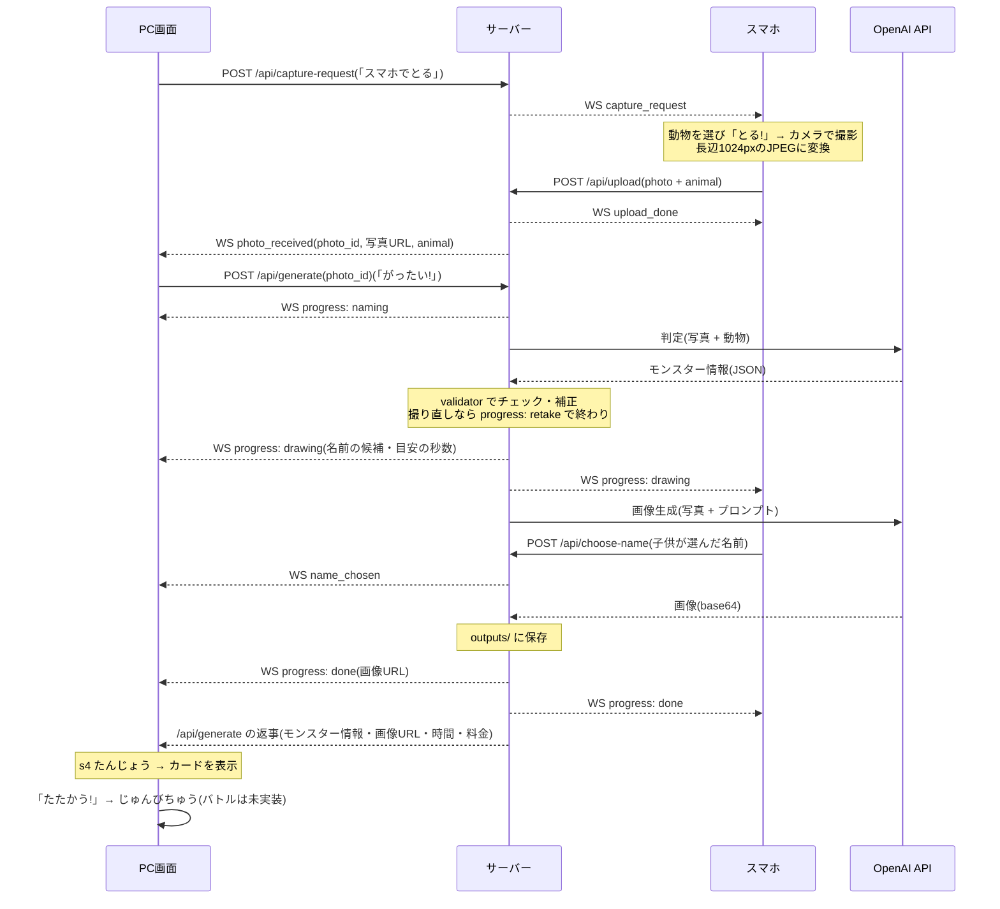

# モンじゃん! 技術ドキュメント

このリポジトリ(`monjan-prototype`)の全体像を、チームのメンバー向けにまとめたものです。
コードから読み取れないことは「**要確認**」と書いています。

- 起動や設定の細かい手順:[README.md](../README.md)
- 開発のルール・仕様の決めごと:[CLAUDE.md](../CLAUDE.md)

---

## 1. これは何か

2027年1月初旬にイオンモールで行う展示用ゲーム「モンじゃん!」の**プロトタイプ**です。
子供がスマホで**動物**を選び、**身の回りの物**を撮ると、AI(OpenAI API)が両方を合体させたモンスターの情報と絵を作ります。

このリポジトリにあるのは「写真 + 動物 → モンスター」の部分だけです。

| 部分 | このリポジトリでの状態 |
|---|---|
| 撮影 → 判定 → 画像生成 → 結果の表示と保存 | **できている** |
| じゃんけんバトル | **ない**。「たたかう!」ボタンは「じゅんびちゅう」と出すだけ。対戦システムは別の担当(**要確認**:どのリポジトリか、モンスターのデータをどう渡すか) |
| カードの生成・印刷 | **ない**。「いんさつ」ボタンは「じゅんびちゅう」と出すだけ(**要確認**:印刷の方式・用紙) |
| タイトル画面 | **ない**(対戦システムの側にある予定。**要確認**) |

---

## 2. システム全体の構成



- **ノートPC 1台**でサーバーを動かし、同じPCのブラウザ(展示の大画面)と、来場者が使うスマホのブラウザがつなぐ
- スマホにアプリは要らない(ブラウザだけ)。**PCとスマホは同じ Wi-Fi** につなぐ(公共・ゲスト用の Wi-Fi は端末同士の通信が禁止されていることが多い)
- サーバーは `0.0.0.0` で待ち受ける。スマホは `http://<PCのLAN内IP>:8000/phone` を開く(PC画面の開発者メニューにURLとQRコードが出る)
- **リアルタイムの合図は WebSocket**、**写真などのデータは HTTP POST**
- OpenAI API は2つ使う
  - **判定**(テキスト用モデル):写真と動物から、物の名前・性質・モンスター名・説明文・絵の設計図を JSON で返してもらう
  - **画像生成**(画像生成モデル):写真とプロンプトから、モンスターの絵を作る
- HTTPS は使っていない(そのため、スマホのカメラは `getUserMedia` ではなく `<input type="file" capture>` で開く)

---

## 3. 画面と処理の流れ

### 3-1. 場面

PC画面(1920×1080 の大画面)は4つの場面を順に進みます。操作は3つのボタン(キーボードの ← / Enter・Space / →)。

| 場面 | PC画面 | スマホ |
|---|---|---|
| s1 しゃしんを とろう | 「スマホで とる」ボタン | 待機中「PCの ボタンを まってね」 |
| s2 しゃしん × どうぶつ = ? | 届いた写真と動物。「がったい!」/「とりなおす」 | 「おくったよ!」 |
| s3 がったい中 | 進み具合・あそびかた・名前の候補 | 名前を選ぶ「この なまえに する! / ほかに さがす」 |
| s4 たんじょう | モンスターのカード。「もう一回」/「たたかう!」/「いんさつ」 | できあがったモンスターの名前と絵 |

### 3-2. 流れ



ポイント:

- **動物を選ぶのはスマホ**。写真と動物は一緒に送り、サーバーが `photo_id` に紐づけて覚える。動物名は一覧(10種類)から選ぶが、サーバーは一覧にない名前でも受け付ける(製品版で自由入力にする予定のため)
- 写真はスマホ側で canvas を使って**長辺1024pxの JPEG** にしてから送る(容量を減らすのと、iPhone の HEIC 対策)。サーバーは Pillow で開けるかを確かめる
- **撮り直し**(人が写っている・物がはっきりしない・子供にふさわしくない物。判定の返答を読めないときも)と判定されたら、画像生成は呼ばずに終わる
- **名前は子供がスマホで選ぶ**。判定で作った候補(チェックに合格したもの)を順に見せる。画像ができてから20秒選ばなければ、出ている名前に決まる
- 画像ができるまで:判定 約8〜16秒 + 画像生成 約25〜40秒(どちらもコメント・記録上の実測。**要確認**:展示で使う設定での最新の値)
- バトルへの受け渡しは**未実装**(**要確認**)

---

## 4. ファイル・ディレクトリの役割

```
monjan-prototype/
├── app/                 サーバー(Python)
│   ├── main.py          FastAPI の入口。画面・API・WebSocket のルーティング、生成の流れ
│   ├── ws_manager.py    WebSocket の接続管理(PC用・スマホ用)とメッセージの送信
│   ├── recognizer.py    判定(テキスト用モデル)。構造化出力で JSON を受け取る
│   ├── generator.py     画像生成(画像生成モデル)。別のサービスに差し替えられる作り(ImageGenerator)
│   ├── prompts.py       AI への指示文・プロンプトのテンプレート・名前のつけ方・ランダムに選ぶ候補
│   ├── validator.py     判定の返答のチェックと補正(不正な値を既定値で補う)
│   ├── animals.py       動物の一覧とアイコン
│   ├── openai_client.py OpenAI クライアントの共通処理(APIキー・タイムアウト・からうちモード)
│   ├── pricing.py       料金の単価と試算
│   ├── storage.py       結果の保存と、料金の累計の記録
│   ├── net_utils.py     PC の LAN 内 IP アドレスの取得
│   └── kiosk.py         起動時に PC 用ページをキオスクモード(全画面)で開く
├── static/              画面(HTML・CSS・素の JavaScript)
│   ├── common/          PC 画面の共通部分
│   │   ├── app.js       場面の進行・ボタン・WebSocket・開発者メニュー(どのテーマでも同じ)
│   │   ├── sound.js     効果音
│   │   └── common.css   舞台の拡大縮小・開発者メニューの見た目
│   ├── themes/<名前>/   PC 画面の見た目(テーマ)。index.html・style.css・theme.json
│   │                    lab / fantasy / cardpack / pot / gacha / summon。fantasy は effects.js で演出を足している
│   ├── phone.html / phone.js / phone.css   スマホ用ページ
│   ├── vendor/          ライブラリとフォント(ネットから読まないよう手元に置いている)
│   └── sounds/          効果音(今は仮の音)
├── tests/               pytest のテスト(API は呼ばない)
├── archive/             作り直す前のファイルの控え
├── uploads/             スマホから届いた写真の一時置き場(Git に入れない)
├── outputs/             生成結果(Git に入れない)
├── .env.example         設定のひな形(.env にコピーして使う。.env は Git に入れない)
├── requirements.txt     Python のライブラリ(requirements-dev.txt はテスト用を足したもの)
├── README.md            起動手順・料金など
└── CLAUDE.md            開発のルールと仕様
```

### 生成結果(`outputs/`)

1回の生成ごとに `outputs/YYYYMMDD_HHMMSS/` ができます。

| ファイル | 内容 |
|---|---|
| `photo.jpg` | 届いた写真(縮小後) |
| `monster.png` | 生成されたモンスターの絵(既定 1024×768) |
| `result.json` | 判定結果(`monster`)・使った設定(`settings`)・処理時間(`timings`)・料金の試算(`usage`)・画像プロンプト |

ほかに `outputs/api_usage_log.jsonl`(料金の累計)と `outputs/name_tests.jsonl`(名前のテストの結果)があります。

### PC 画面のテーマ

- 見た目はテーマごとに `static/themes/<名前>/` に分かれていて、`/?theme=<名前>` で切りかえる(何も付けないときは `.env` の `PC_THEME`)
- 動きは共通の `app.js` が受け持つので、テーマはフォルダを足すだけで増やせる。テーマに用意する要素(ID)は `app.js` の先頭のコメント「テーマとの約束」にある
- API を使わずに場面を確認できる:`/?theme=fantasy&demo=1&scene=s3&progress=0.8`、`&play=birth` で誕生の演出、`&dev=1` で開発者メニュー。`&photo=`・`&img=` を付けなければ見本の写真と絵(`static/demo/`)を使う

---

## 5. API エンドポイント

フォームの送信は `multipart/form-data`(FastAPI の `Form` / `File`)。

### 画面

| メソッド | パス | 内容 |
|---|---|---|
| GET | `/` | PC 用ページ。`?theme=` でテーマを選ぶ |
| GET | `/phone` | スマホ用ページ |
| GET | `/static/...` | 静的ファイル |
| GET | `/api/photo/{photo_id}` | 届いた写真(JPEG)。生成が終わると `uploads/` から消すので 404 になる |
| GET | `/api/monster-image/{photo_id}` | できたモンスターの絵(PNG)。サーバーを再起動すると前の絵は 404 |

`uploads/`・`outputs/` は丸ごとは公開しない(`outputs/` のフォルダ名は日時で推測できるため、子供の写真を守る)。
`photo_id` は32文字の16進数で、形が違えば 400。

### API

| メソッド | パス | 入力 | 出力 |
|---|---|---|---|
| POST | `/api/capture-request` | なし | `{ok, sent}`。スマホに `capture_request` を送る。スマホがつながっていなければ 409 `{ok:false, error}` |
| POST | `/api/upload` | `photo`(画像ファイル)、`animal`(文字列) | `{ok, photo_id, photo_url, animal}`。空・画像でないときは 400 |
| POST | `/api/generate` | `photo_id` | 下の「/api/generate の返事」。`photo_id` がなければ 404。生成中にもう一度呼ぶと 409(同時に2つは作らない) |
| POST | `/api/choose-name` | `photo_id`、`name` | `{ok, name}`。候補にない名前は 400、候補がなければ 404。画像ができたあとなら `result.json` も書きかえる |
| POST | `/api/name-test` | `animal`、`object_name`、`count`(1〜10) | `{ok, animal, object_name, runs[], total_cost_usd, total_cost_yen, cumulative_cost_yen}`。写真も画像生成も使わず、名前だけを作る(開発用) |
| GET | `/api/animals` | なし | `{animals[], icons{}, default_icon}` |
| GET | `/api/themes` | なし | `{themes[{id, name, description}], default}` |
| GET | `/api/info` | なし | `{phone_url, phone_connected, text_model, image_model, image_quality, image_size, image_prompt_style}` |
| GET | `/api/qr` | なし | スマホ用 URL の QR コード(PNG) |

#### `/api/generate` の返事

失敗しても HTTP は 200 で、`ok` で見分けます(画面にエラーをそのまま出すため)。

| 場合 | 主な中身 |
|---|---|
| 成功 | `ok: true`、`needs_retake: false`、`monster`、`monster_url`、`output_dir`、`settings`、`timings`、`usage`、`validator_notes`、`generator_notes` |
| 撮り直し | `ok: true`、`needs_retake: true`、`retake_reason`、`monster`、`timings`、`usage` |
| 失敗 | `ok: false`、`step`(「判定」「画像生成」、保存などの思わぬエラーは「サーバー」)、`error`、(判定まで済んでいれば)`monster`・`usage`。どの失敗でも WebSocket で `progress: error` を送る |

`monster` の主な項目:`object_name`(物の名前)・`element`(性質:あつい / みず / でんき / かたい / とがってる / やわらかい)・`monster_name`・`name_candidates`・`description`・`needs_retake`・`retake_reason`・`has_person`・`design_plan`(絵の設計図)。
性質 `element` は絵には使っておらず、バトル用に保存しているだけです(**要確認**:バトルでの使い方)。

### WebSocket(`/ws?role=pc` または `/ws?role=phone`)

サーバーから送るだけです(PC・スマホからの受信は使っていない)。

| 宛先 | `type` | 中身 |
|---|---|---|
| スマホ | `capture_request` | 撮影してほしい |
| スマホ | `upload_done` | `photo_id`。写真を受け取った |
| PC | `phone_status` | `connected`。スマホがつながっているか |
| PC | `photo_received` | `photo_id`、`photo_url`、`animal` |
| PC・スマホ | `progress` | `stage`:`naming` / `drawing` / `done` / `retake` / `error`。`drawing` には `name_choices`・`expected_seconds`、`done` には `image_url` |
| PC | `name_chosen` | `photo_id`、`name` |

---

## 6. 使っているライブラリ

### サーバー(`requirements.txt`)

| ライブラリ | 用途 |
|---|---|
| FastAPI | Web サーバー・API・WebSocket |
| Uvicorn | FastAPI を動かすサーバー |
| python-multipart | フォーム・ファイルの受け取り |
| python-dotenv | `.env` から設定を読む |
| Pillow | 写真が開けるかの確認、からうちモードのダミー画像 |
| openai | OpenAI API(判定・画像生成)。`responses.parse` を使うので 3.40.0 以上(動作を確かめた版) |
| pydantic | 判定の返答の形(fastapi と一緒に入る) |
| qrcode | スマホ用 URL の QR コード |
| pytest・httpx | テスト(`requirements-dev.txt`) |

### 画面(`static/vendor/` に置いてある。ネットから読まない)

| ライブラリ | 版 | 用途 | ライセンス |
|---|---|---|---|
| GSAP(+ SplitText) | 3.15.0 | たまごテーマの誕生の演出・名前が1文字ずつ跳ねる | GSAP 標準ライセンス(無料・商用可) |
| tsParticles | 4.5.0 | たまごテーマの光の粒・葉っぱの紙吹雪 | MIT |
| Howler.js | 2.2.4 | 効果音 | MIT |
| フォント(Google Fonts から保存) | — | 各テーマとスマホの文字 | SIL OFL 1.1 |

画面はフレームワークを使わない、素の JavaScript です。

### OpenAI のモデル(`.env` で切りかえ)

| 用途 | 設定 | コードやドキュメントに出てくるモデル |
|---|---|---|
| 判定 | `TEXT_MODEL` | `gpt-6-luna`(画像入力・構造化出力に対応) |
| 画像生成 | `IMAGE_MODEL`・`IMAGE_QUALITY`・`IMAGE_SIZE` | `gpt-image-2.5-sunburst`(CLAUDE.md 上の現在の設定)/ `gpt-image-2` / `gpt-image-2.5-flare` / `gpt-image-1-mini` |

**要確認**:展示本番で使うモデルと画質。料金は `app/pricing.py` の単価で試算しています(判定 約0.1円、`gpt-image-2` / medium / 1024×768 で画像 約7.4円。sunburst の実際の料金は `result.json` の `usage` で確認)。

---

## 7. ローカルでの起動手順

Windows で動かすことを前提にしています(キオスクモードは Edge / Chrome を探して開きます。**要確認**:Mac での動作)。

### 1. 準備

```powershell
# 仮想環境を作って有効にする(このPCでは python がストアのダミーになるので py を使う。README 参照)
py -m venv .venv
.\.venv\Scripts\Activate.ps1

# ライブラリを入れる(テストもするときは requirements-dev.txt)
pip install -r requirements.txt

# 設定ファイルを作り、OPENAI_API_KEY などを書く
Copy-Item .env.example .env
```

- Python は 3.11 以上(CLAUDE.md の指定。手元では 3.14 で動かしている)
- 設定の項目と意味は `.env.example` と README の表を参照

### 2. まずは料金0円で動かす

API を呼ぶと実費がかかります(1回の生成で約7.5円)。画面やスマホの接続を確かめるだけなら、`.env` を次のようにします。

```
DRY_RUN=true
```

からうちモードでは OpenAI API を一切呼ばず、決まった判定結果と「DRY RUN」と書かれたダミー画像を返します。

> **注意**:設定は `.env` の値が優先されます(`load_dotenv(override=True)`)。
> ターミナルで `$env:DRY_RUN="true"` としてから起動しても、`.env` が `false` なら API を呼びます。必ず `.env` を書きかえてください。

### 3. 起動

```powershell
python -m app.main
```

- ターミナルに PC 用とスマホ用の URL が出る
- PC 用ページがキオスクモード(全画面)で開く。終わるときは **Alt + F4**。自分でブラウザを開きたいときは `.env` を `KIOSK_MODE=false`
- スマホで、表示された URL(または開発者メニューの QR コード)を開く
- 初回は Windows のファイアウォールの警告が出るので、**プライベートネットワーク**を許可する(許可しないとスマホからつながらない)

### 4. 操作

| キー | 動き |
|---|---|
| ← / Enter・Space / → | 画面下の3つのボタン |
| D(または右下の歯車) | 開発者メニュー(判定の JSON・時間・料金・テーマの切りかえ・名前のテスト) |

### 5. テスト

```powershell
python -m pytest
```

チェックの規則(`validator.py`)と、写真を送る → 生成 → 名前を選ぶ流れを確かめます。からうちモードで動かし、API を呼ぼうとしたら失敗するようにしてあるので、料金はかかりません。

---

## 8. 要確認の一覧

| 項目 | 内容 |
|---|---|
| バトルとのつなぎ方 | 対戦システムがどこにあり、モンスターのデータ(名前・絵・性質)をどう渡すか |
| カードの印刷 | 印刷の方式・用紙・プリンター |
| タイトル画面 | 対戦システムの側にあるのか |
| 展示本番の設定 | 使うモデル・画質・テーマ・`ALLOW_PERSON`(人が写った写真を使うか) |
| 会場のネットワーク | 会場の Wi-Fi で PC とスマホがつながるか(テザリングにするか) |
| 失敗したときの代わりの画像 | 本番では用意した画像を使う予定だが、まだない |
| 処理時間 | 展示で使う設定での最新の実測 |
| スマホの実機 | iPhone・Android でカメラと送信が動くか(README では「残っている確認」) |
| 効果音 | 今は仮の音。素材はまだ決まっていない |
| Mac での動作 | 起動手順は Windows だけで確かめている |
